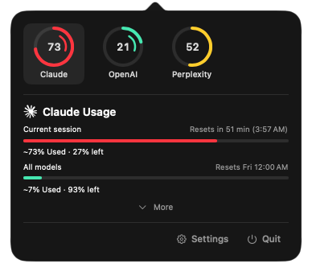

# Leftover

A macOS menu bar app that shows how much of your AI coding tools' usage limits
is left.

<p align="center"></p>

Leftover sits in the menu bar. Click it for a panel with a ring for every
connected account; hover a ring for that account's limits and when they reset.

## Features

**Usage limits**
- A ring per account, coloured by how close it is to the limit, with the
  percentage inside. Click a ring to read it again right away.
- Every limit window an account has (session, weekly, per model, monthly
  credits), each with how much is used, how much is left and when it resets.
- **More** opens the full card: the agent sessions running now, reset credits,
  Codex token usage and a DeepSeek cost breakdown.
- What used a Claude or Codex allowance: the projects behind it this week, and
  what that share is worth.

**Supported tools**
- Coding agents and editors: Claude Code (and Claude Desktop), Codex, Cursor,
  Antigravity, GitHub Copilot, Grok, OpenCode, Kiro, Kilo, Amp, Devin,
  Command Code, Gemini CLI and API.
- Model platforms: GLM (Z.ai), Kimi, MiniMax, DeepSeek, Qwen, Qoder, Apify,
  Higgsfield.
- Local model servers: Ollama, LM Studio and oMLX, with the loaded model,
  its context use and tokens per second.

**No passwords**
- Every reading comes from the sign-in already on your Mac: the CLI's or app's
  own credentials, read and never written. Platforms with only a web console
  (DeepSeek, Qwen, MiniMax) sign in inside Leftover's own browser window.

**Notifications**
- When a limit runs out, when it resets, and when an agent finishes its turn or
  stops to ask you something. Each one can be switched on or off, with or
  without sound.

**Your way**
- Menu bar title: logo only, a percentage, or name and percentage, for the
  provider you pick or the most used one; show what is used or what is left.
- Ring order: by hand, by what is left, or by how far ahead of pace you are.
- Light, dark or system theme, adjustable panel transparency, English and
  Turkish, open at login.

## Credits

Leftover is a fork of [**codenotch**](https://github.com/vinzdg/codenotch) by
Vinz, which pins the same usage readings to a screen edge. Nearly all of the
provider integrations, session monitors and cost tracking come from codenotch.
Leftover replaces the notch with a menu bar panel and trims what that no longer
needs. Thank you, Vinz.

## Requirements

macOS 15 or later.

## Install

Homebrew: coming soon.

To build from source you need Xcode and [XcodeGen](https://github.com/yonaskolb/XcodeGen)
(`brew install xcodegen`):

```sh
make run
```

`make run` generates the Xcode project, builds a Debug copy and launches it.
Builds are ad-hoc signed, so they run on your own Mac.

`make test` runs the unit tests.

### Signing with a Developer ID

Leftover reads Claude Code's token from the login keychain, and the keychain
remembers which signed binary you allowed. An ad-hoc build gets a new identity
every time, so macOS asks again after each rebuild. To avoid that, sign with
your own Developer ID:

```sh
cp Local.xcconfig.example Local.xcconfig   # then set DEVELOPMENT_TEAM
```

`make release` builds a signed, notarized DMG in `dist/` (it also needs a
`notarytool` keychain profile; see `Scripts/release.sh`).

### Demo mode

`LEFTOVER_DEMO=1` fills the panel with sample data, which is handy for
screenshots:

```sh
LEFTOVER_DEMO=1 build/DerivedData/Build/Products/Debug/Leftover.app/Contents/MacOS/Leftover
```

## License

[MIT](LICENSE).

Bundled third-party components keep their own licenses:

- [Zstandard](https://github.com/facebook/zstd) decoder, BSD, `Sources/Vendor/zstd/LICENSE`
- [holiday-cn](https://github.com/NateScarlet/holiday-cn) data, MIT, `Sources/Resources/holiday-cn-LICENSE.txt`
- [Lobe Icons](https://github.com/lobehub/lobe-icons), MIT, `Sources/Resources/LobeIcons-LICENSE.txt`

Product names and logos belong to their owners and are used only to identify
the services Leftover reads. Leftover is not affiliated with or endorsed by any
of them.
